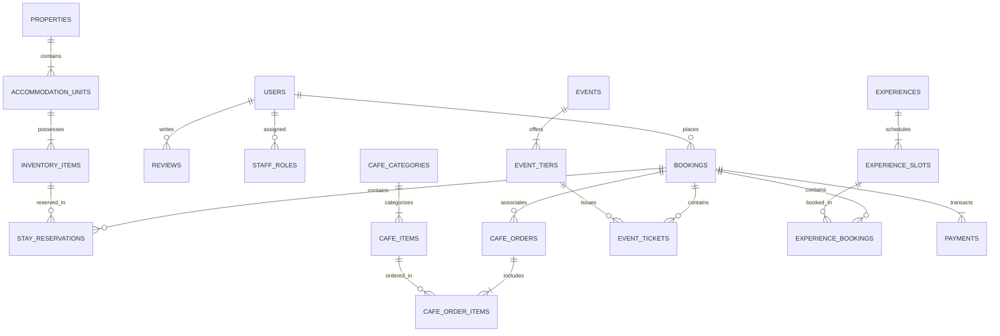

# MAGICA — Database Architecture & Schema Specification

**Document Version:** 1.0.0  
**Database Engine:** MySQL 8.0+ / MariaDB 10.6+ (InnoDB Engine)  
**Encoding:** `utf8mb4_unicode_ci`  
**Timezone Standard:** Stored in UTC (`TIMESTAMP` / `DATETIME`), displayed in `Asia/Kolkata`  
**Monetary Standard:** Integer Minor Units (`BIGINT` or `INT` paise)  

---

## 1. Entity-Relationship Overview



---

## 2. Core Tables Schema

### A. Users & RBAC
```sql
CREATE TABLE users (
    id BIGINT UNSIGNED AUTO_INCREMENT PRIMARY KEY,
    name VARCHAR(255) NOT NULL,
    email VARCHAR(255) NOT NULL UNIQUE,
    phone VARCHAR(20) NULL UNIQUE,
    password_hash VARCHAR(255) NULL, -- Nullable for OTP/magic-link guests
    role ENUM('guest', 'super_admin', 'business_manager', 'reception', 'cafe_manager', 'kitchen_staff', 'event_staff', 'guide') DEFAULT 'guest',
    avatar_url VARCHAR(500) NULL,
    created_at TIMESTAMP DEFAULT CURRENT_TIMESTAMP,
    updated_at TIMESTAMP DEFAULT CURRENT_TIMESTAMP ON UPDATE CURRENT_TIMESTAMP,
    INDEX idx_user_email (email),
    INDEX idx_user_role (role)
) ENGINE=InnoDB;
```

### B. Accommodation Module (STAY)
```sql
CREATE TABLE accommodation_units (
    id BIGINT UNSIGNED AUTO_INCREMENT PRIMARY KEY,
    title VARCHAR(255) NOT NULL, -- e.g., "6-Bed Mixed Dorm", "Parvati Riverside Suite"
    slug VARCHAR(255) NOT NULL UNIQUE,
    unit_type ENUM('dorm_bed', 'private_room') NOT NULL,
    capacity INT UNSIGNED NOT NULL, -- Number of guests per unit
    base_price_paise INT UNSIGNED NOT NULL, -- Price in paise (e.g. 80000 = ₹800)
    amenities JSON NOT NULL, -- JSON array of strings
    description TEXT NOT NULL,
    featured_image_url VARCHAR(500) NOT NULL,
    gallery_image_urls JSON NULL,
    is_active BOOLEAN DEFAULT TRUE,
    created_at TIMESTAMP DEFAULT CURRENT_TIMESTAMP
) ENGINE=InnoDB;

-- Specific physical rooms or individual beds
CREATE TABLE accommodation_inventory (
    id BIGINT UNSIGNED AUTO_INCREMENT PRIMARY KEY,
    unit_id BIGINT UNSIGNED NOT NULL,
    identifier VARCHAR(50) NOT NULL, -- e.g., "Room 201", "Dorm A - Bed 3"
    status ENUM('available', 'maintenance', 'blocked') DEFAULT 'available',
    FOREIGN KEY (unit_id) REFERENCES accommodation_units(id) ON DELETE CASCADE
) ENGINE=InnoDB;

CREATE TABLE stay_reservations (
    id BIGINT UNSIGNED AUTO_INCREMENT PRIMARY KEY,
    booking_id BIGINT UNSIGNED NOT NULL,
    inventory_id BIGINT UNSIGNED NOT NULL,
    check_in_date DATE NOT NULL,
    check_out_date DATE NOT NULL,
    guest_count INT UNSIGNED NOT NULL,
    rate_per_night_paise INT UNSIGNED NOT NULL,
    status ENUM('pending_payment', 'confirmed', 'checked_in', 'checked_out', 'cancelled') DEFAULT 'pending_payment',
    hold_expires_at TIMESTAMP NULL, -- 10-minute hold lock
    INDEX idx_stay_dates (check_in_date, check_out_date, status)
) ENGINE=InnoDB;
```

### C. Cafe & Food Ordering Module (EAT)
```sql
CREATE TABLE cafe_categories (
    id BIGINT UNSIGNED AUTO_INCREMENT PRIMARY KEY,
    name VARCHAR(100) NOT NULL,
    slug VARCHAR(100) NOT NULL UNIQUE,
    sort_order INT DEFAULT 0,
    is_active BOOLEAN DEFAULT TRUE
) ENGINE=InnoDB;

CREATE TABLE cafe_items (
    id BIGINT UNSIGNED AUTO_INCREMENT PRIMARY KEY,
    category_id BIGINT UNSIGNED NOT NULL,
    name VARCHAR(255) NOT NULL,
    description TEXT NULL,
    price_paise INT UNSIGNED NOT NULL,
    is_veg BOOLEAN DEFAULT TRUE,
    is_available BOOLEAN DEFAULT TRUE, -- For 86-ing out-of-stock items
    image_url VARCHAR(500) NULL,
    preparation_time_minutes INT DEFAULT 15,
    FOREIGN KEY (category_id) REFERENCES cafe_categories(id)
) ENGINE=InnoDB;

CREATE TABLE cafe_orders (
    id BIGINT UNSIGNED AUTO_INCREMENT PRIMARY KEY,
    order_number VARCHAR(30) NOT NULL UNIQUE, -- e.g. "ORD-20261125-001"
    booking_id BIGINT UNSIGNED NULL, -- Optional if guest is ordering directly
    user_id BIGINT UNSIGNED NULL,
    order_type ENUM('dine_in', 'takeaway') NOT NULL,
    table_number VARCHAR(20) NULL, -- e.g. "T-04" or "Riverside Deck"
    status ENUM('received', 'preparing', 'ready', 'delivered', 'cancelled') DEFAULT 'received',
    payment_mode ENUM('online', 'pay_at_counter') NOT NULL,
    payment_status ENUM('pending', 'paid', 'failed') DEFAULT 'pending',
    subtotal_paise INT UNSIGNED NOT NULL,
    tax_paise INT UNSIGNED DEFAULT 0,
    total_paise INT UNSIGNED NOT NULL,
    special_instructions TEXT NULL,
    created_at TIMESTAMP DEFAULT CURRENT_TIMESTAMP
) ENGINE=InnoDB;

CREATE TABLE cafe_order_items (
    id BIGINT UNSIGNED AUTO_INCREMENT PRIMARY KEY,
    order_id BIGINT UNSIGNED NOT NULL,
    item_id BIGINT UNSIGNED NOT NULL,
    quantity INT UNSIGNED NOT NULL,
    unit_price_paise INT UNSIGNED NOT NULL,
    total_price_paise INT UNSIGNED NOT NULL,
    notes VARCHAR(255) NULL,
    FOREIGN KEY (order_id) REFERENCES cafe_orders(id) ON DELETE CASCADE
) ENGINE=InnoDB;
```

### D. Events & Ticketing Module (CELEBRATE)
```sql
CREATE TABLE events (
    id BIGINT UNSIGNED AUTO_INCREMENT PRIMARY KEY,
    title VARCHAR(255) NOT NULL,
    slug VARCHAR(255) NOT NULL UNIQUE,
    genre VARCHAR(100) NOT NULL, -- e.g., "Psytrance", "Organic Techno", "Acoustic Sunset"
    banner_image_url VARCHAR(500) NOT NULL,
    start_time TIMESTAMP NOT NULL,
    end_time TIMESTAMP NOT NULL,
    location VARCHAR(255) DEFAULT 'MAGICA Main Stage & Courtyard',
    description TEXT NOT NULL,
    is_published BOOLEAN DEFAULT FALSE
) ENGINE=InnoDB;

CREATE TABLE event_tiers (
    id BIGINT UNSIGNED AUTO_INCREMENT PRIMARY KEY,
    event_id BIGINT UNSIGNED NOT NULL,
    name VARCHAR(100) NOT NULL, -- e.g., "Early Bird", "Phase 1 Pass", "VIP Deck"
    price_paise INT UNSIGNED NOT NULL,
    total_capacity INT UNSIGNED NOT NULL,
    allocated_count INT UNSIGNED DEFAULT 0,
    is_active BOOLEAN DEFAULT TRUE,
    FOREIGN KEY (event_id) REFERENCES events(id) ON DELETE CASCADE
) ENGINE=InnoDB;

CREATE TABLE event_tickets (
    id BIGINT UNSIGNED AUTO_INCREMENT PRIMARY KEY,
    ticket_code VARCHAR(64) NOT NULL UNIQUE, -- Unique cryptographic code for QR validation
    booking_id BIGINT UNSIGNED NOT NULL,
    event_tier_id BIGINT UNSIGNED NOT NULL,
    attendee_name VARCHAR(255) NOT NULL,
    attendee_phone VARCHAR(20) NOT NULL,
    status ENUM('active', 'used', 'cancelled') DEFAULT 'active',
    checked_in_at TIMESTAMP NULL,
    checked_in_by BIGINT UNSIGNED NULL,
    FOREIGN KEY (event_tier_id) REFERENCES event_tiers(id)
) ENGINE=InnoDB;
```

### E. Experiences & Treks (EXPLORE)
```sql
CREATE TABLE experiences (
    id BIGINT UNSIGNED AUTO_INCREMENT PRIMARY KEY,
    title VARCHAR(255) NOT NULL, -- e.g. "Grahan Village Heritage Hike"
    slug VARCHAR(255) NOT NULL UNIQUE,
    difficulty ENUM('easy', 'moderate', 'challenging', 'extreme') NOT NULL,
    duration_hours INT NOT NULL,
    price_per_person_paise INT UNSIGNED NOT NULL,
    max_group_size INT UNSIGNED NOT NULL,
    description TEXT NOT NULL,
    meeting_point VARCHAR(255) NOT NULL,
    created_at TIMESTAMP DEFAULT CURRENT_TIMESTAMP
) ENGINE=InnoDB;

CREATE TABLE experience_slots (
    id BIGINT UNSIGNED AUTO_INCREMENT PRIMARY KEY,
    experience_id BIGINT UNSIGNED NOT NULL,
    guide_id BIGINT UNSIGNED NULL,
    slot_start TIMESTAMP NOT NULL,
    booked_count INT UNSIGNED DEFAULT 0,
    status ENUM('open', 'full', 'cancelled', 'completed') DEFAULT 'open',
    FOREIGN KEY (experience_id) REFERENCES experiences(id)
) ENGINE=InnoDB;
```

### F. Unified Bookings & Payments
```sql
CREATE TABLE bookings (
    id BIGINT UNSIGNED AUTO_INCREMENT PRIMARY KEY,
    booking_reference VARCHAR(32) NOT NULL UNIQUE, -- e.g. "MGK-202611-X489"
    user_id BIGINT UNSIGNED NOT NULL,
    status ENUM('pending', 'confirmed', 'completed', 'cancelled') DEFAULT 'pending',
    total_amount_paise INT UNSIGNED NOT NULL,
    currency VARCHAR(3) DEFAULT 'INR',
    notes TEXT NULL,
    created_at TIMESTAMP DEFAULT CURRENT_TIMESTAMP
) ENGINE=InnoDB;

CREATE TABLE payments (
    id BIGINT UNSIGNED AUTO_INCREMENT PRIMARY KEY,
    booking_id BIGINT UNSIGNED NOT NULL,
    gateway ENUM('razorpay', 'cash', 'upi_counter') NOT NULL,
    gateway_order_id VARCHAR(100) NULL,
    gateway_payment_id VARCHAR(100) NULL,
    gateway_signature VARCHAR(255) NULL,
    amount_paise INT UNSIGNED NOT NULL,
    status ENUM('created', 'authorized', 'captured', 'refunded', 'failed') DEFAULT 'created',
    raw_response JSON NULL,
    verified_at TIMESTAMP NULL,
    created_at TIMESTAMP DEFAULT CURRENT_TIMESTAMP,
    FOREIGN KEY (booking_id) REFERENCES bookings(id)
) ENGINE=InnoDB;
```
