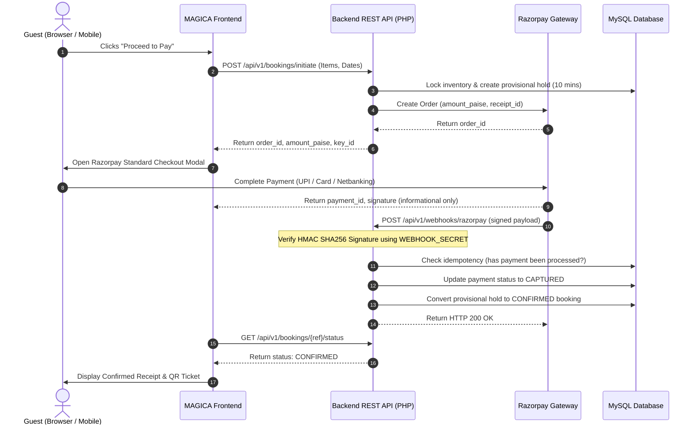

# MAGICA — Security & Business Integrity Architecture

**Document Version:** 1.0.0  
**Author:** Lead Software Architect  

---

## 1. Core Security Tenets

1. **Zero Client Trust**: All authorization checks, pricing calculations, inventory deductions, and payment status transitions occur strictly on the authoritative backend.
2. **No Secrets in Frontend Bundles**: No private API keys, database credentials, webhook secrets, or Razorpay Secret Keys are ever compiled into client-side JavaScript. Only public keys (e.g. `NEXT_PUBLIC_RAZORPAY_KEY_ID`) are exposed.
3. **Defense Against Double Spending & Overselling**: Concurrency control via transactional row-locking (`SELECT ... FOR UPDATE`) and temporary 10-minute provisional holds.
4. **Idempotent Webhook Verification**: Razorpay payment webhooks are cryptographically validated against `RAZORPAY_WEBHOOK_SECRET` using HMAC-SHA256 signatures before modifying any reservation record.

---

## 2. Authentication & Authorization (RBAC)

### Token Architecture (Laravel Sanctum Compatible)
- Frontend authenticates by posting credentials to `/api/v1/auth/login`.
- The backend validates credentials and issues an encrypted Personal Access Token (`magica_pat_...`).
- The token is passed via standard HTTP headers: `Authorization: Bearer <token>`.
- Client storage: Stored in memory / secure `localStorage` with automatic token expiration and refresh handling.

### Role-Based Access Control (RBAC) Matrix

| Module / Action | Guest | Reception | Cafe / Kitchen | Event Staff | Guide | Business Mgr | Super Admin |
| :--- | :---: | :---: | :---: | :---: | :---: | :---: | :---: |
| **Browse Public Offerings** | Read | Read | Read | Read | Read | Read | Read |
| **Create Stay / Cafe / Event Booking** | Create | Create | - | - | - | Create | Create |
| **Manage Room Allocations / Check-ins** | - | Full | - | - | - | Full | Full |
| **Update Kitchen Order Status** | - | - | Full | - | - | Full | Full |
| **Validate Event QR Tickets** | - | - | - | Full | - | Full | Full |
| **View Assigned Trek Rosters** | - | - | - | - | Full | Full | Full |
| **Financial Reports & Audit Logs** | - | - | - | - | - | Read | Full |
| **Staff & Permission Admin** | - | - | - | - | - | - | Full |

---

## 3. Payment Processing & Webhook Lifecycle

---

## 4. Input Validation & Data Sanitization

1. **Frontend Layer**: Form inputs are validated in real-time with **Zod** schemas matching the backend contract to provide immediate, actionable feedback to users.
2. **Backend Layer**: Every incoming payload is validated with strict Laravel `FormRequest` classes (whitelisting allowed parameters, stripping dangerous tags, enforcing numerical bounds).
3. **SQL Injection Defense**: 100% parameterized queries via PDO / Eloquent ORM. No raw string interpolation into database statements.
4. **Cross-Site Scripting (XSS)**: All user inputs (guest notes, reviews) are sanitized, and React automatically escapes JSX expressions.
