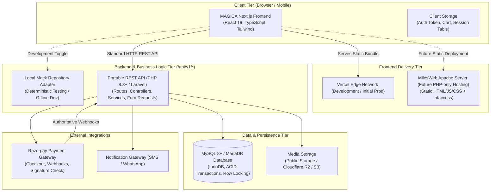

# MAGICA — System Architecture Specification

**Document Version:** 1.0.0  
**Status:** Approved for Phase 0  
**Author:** Lead Software Architect  

---

## 1. High-Level Architectural Vision

MAGICA is engineered following a **Decoupled Monolith / Headless Platform Pattern**. The architecture is deliberately designed to run today as a high-performance modern web application on **Vercel** while ensuring an effortless transition to an independently hosted **PHP/Laravel REST API** with a **Static/SPA Frontend** on **MilesWeb Shared Hosting**.

---

## 2. Layered Component Architecture

### A. Frontend Presentation Layer (`src/app/`, `src/components/`, `src/modules/`)
- **Domain Modules:** The codebase is partitioned into distinct vertical business domains:
  - `src/modules/accommodation`: Room types, bed filters, booking wizard.
  - `src/modules/cafe`: Menu grid, category switcher, QR table context, order cart.
  - `src/modules/events`: Event cards, tier selectors, countdowns, attendee intake.
  - `src/modules/experiences`: Trek itineraries, difficulty badges, slot pickers.
  - `src/modules/music`: Audio stream controls, playlist renderers, track info.
  - `src/modules/bookings`: Unified booking summary, price breakdown, guest details.
  - `src/modules/payments`: Payment mode selector, Razorpay modal launcher, receipt display.
  - `src/modules/users`: Auth modals, profile settings, ticket wallet, booking list.
- **Shared UI Primitives (`src/components/ui/`):** Reusable buttons, badges, modals, drawers, input fields, cards, tabs, and skeletons styled with Tailwind CSS following the MAGICA dark luxury design language.
- **State Management:**
  - Fast, localized React state (`useState`, `useReducer`) for UI interactivity.
  - Modular Custom Hooks with `localStorage` persistence for the active shopping cart and QR table number.
  - Remote data synchronization via dedicated Service Clients (`src/services/`).

### B. Service Abstraction Layer (`src/services/`)
To preserve absolute portability and allow seamless switching between mock data and the live PHP REST API:
- Every module accesses data strictly through an abstract TypeScript interface (e.g., `AccommodationService`, `CafeService`, `EventService`, `BookingService`).
- A single configuration switch (`NEXT_PUBLIC_USE_MOCK_API=true/false`) directs requests to either:
  1. **In-Memory Deterministic Mock Repositories** (ideal for rapid UI development, offline testing, and initial Vercel previews).
  2. **Standard HTTP Fetch API Client** pointing to `NEXT_PUBLIC_API_BASE_URL` (PHP 8.3+ REST API).
- No direct database queries, Next.js Server Actions, or proprietary Vercel APIs exist within any UI component.

---

## 3. Data Integrity & Concurrency Architecture

### Prevent Double Bookings & Overselling
Accommodation beds, trek guide capacity, and event tickets are strictly limited resources. The booking flow enforces two-phase inventory locking:
1. **Provisional Hold (Phase 1):** When a user enters checkout, the backend attempts to acquire an inventory lock using an atomic SQL statement with `SELECT ... FOR UPDATE` or an active reservations timestamp check. A temporary hold record is inserted with `expires_at = NOW() + INTERVAL 10 MINUTE`.
2. **Authoritative Confirmation (Phase 2):** When the Razorpay payment webhook is validated with HMAC SHA256 signature verification, the hold is converted to `confirmed`.
3. **Auto-Expiry Cleanup:** If payment fails or the 10-minute window elapses without capture, the hold record becomes inactive, releasing the inventory back to the live pool.

### Monetary Calculations
- Standardized to **integer minor units** (Indian Paise).
- Total = `base_price_paise + tax_paise - discount_paise`.
- Prevents binary IEEE-754 floating-point rounding errors during currency math.

### Timezone Handling
- All customer displays, event schedules, check-in deadlines, and kitchen orders are explicitly displayed in `Asia/Kolkata` (IST, UTC+5:30).
- Timestamps in the database are stored in UTC ISO-8601 (`YYYY-MM-DD HH:MM:SS` or `TIMESTAMP`).
